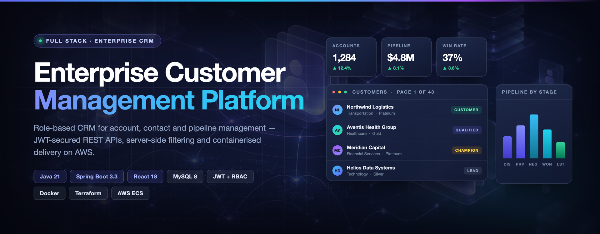
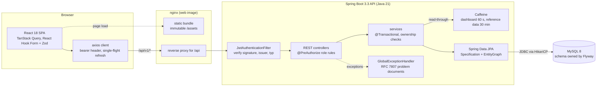
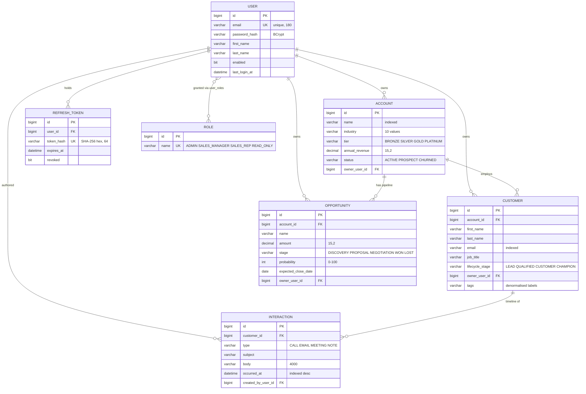
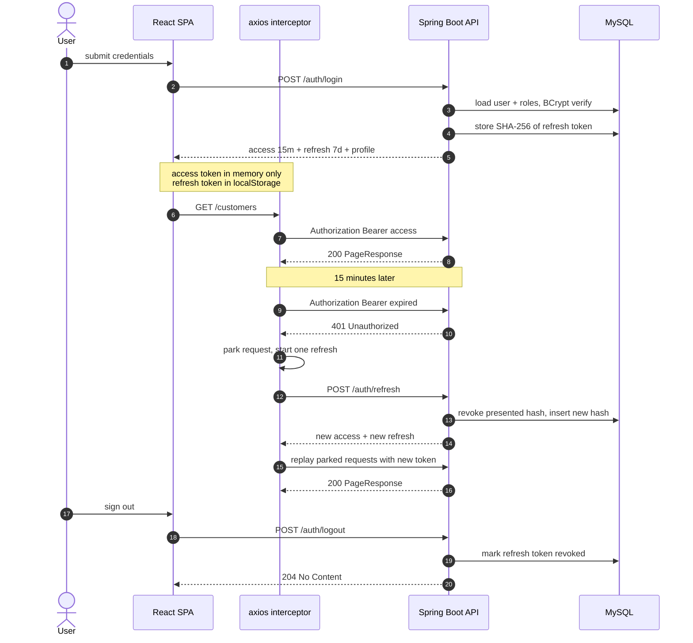
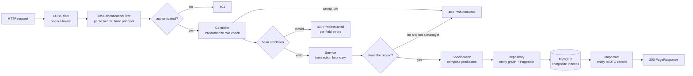
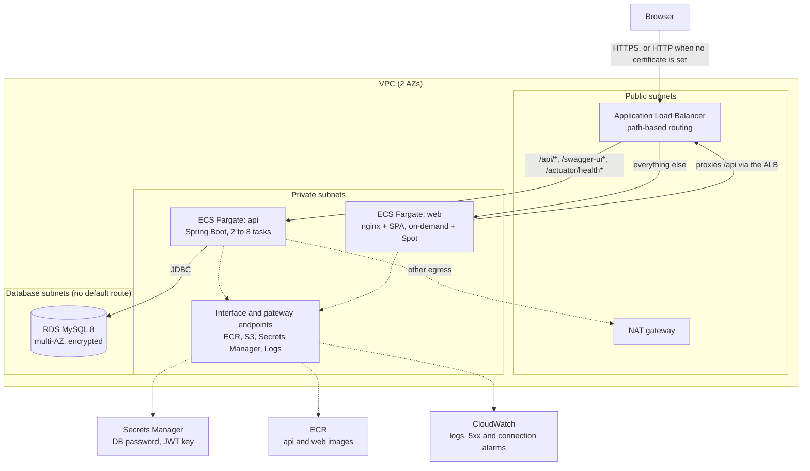
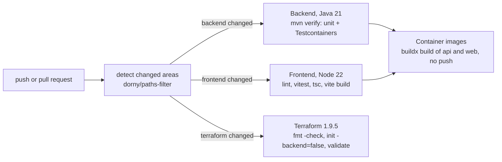

# enterprise-customer-management-platform

A B2B CRM, accounts, contacts, interactions and a deal pipeline with four-role access control,
built as a Spring Boot 3.3 / Java 21 API, a React 18 + TypeScript SPA, MySQL 8, and Terraform for
AWS ECS Fargate.

[](https://github.com/csalekhya/enterprise-customer-management-platform/actions/workflows/ci.yml)



## Why

A sales team needs three answers it can trust: *who are we selling to, what has been said to
them, and what is the pipeline worth?* Spread across a spreadsheet, an inbox and someone's memory,
those answers disagree. This platform keeps companies (**accounts**), the people in them
(**contacts**), every touchpoint (**interactions**) and every deal (**opportunities**) in one
relational model with an audit trail, and gives each role exactly the access it should have:
a rep can read the whole book of business but change only their own records.

## Features

- **Accounts as the aggregate root.** Contacts, deals and interactions all hang off an account;
  accounts carry a tier (BRONZE → PLATINUM), an industry and a lifecycle status.
- **Two-level authorization.** `@PreAuthorize` decides whether a role may call a route; a
  service-layer ownership check decides whether *this* user may change *this* row. ADMIN and
  SALES_MANAGER bypass the ownership check; SALES_REP must own the record; READ_ONLY gets GET only.
- **JWT access + rotating refresh tokens.** 15-minute HS256 access tokens (no session store, no
  database hit per request) and 7-day refresh tokens that rotate on every use, are stored only as a
  SHA-256 digest, and revoke the user's whole chain when a rotated token is replayed.
- **Server-side paging, sorting and filtering.** Six composable filters on contacts and six on
  accounts, built with JPA `Specification` so every literal is a bound parameter. Page size is
  capped at 100 server-side.
- **Pipeline dashboard from database aggregates.** One request, nine SQL statements regardless of
  data volume, behind a 60-second Caffeine cache that a stage change evicts.
- **Audit columns everywhere.** `createdBy` / `updatedBy` / timestamps stamped by Spring Data JPA
  auditing, plus an append-only interaction timeline per contact.
- **Uniform errors.** Every failure is an RFC 7807 `application/problem+json` document with a
  stable `type` URI and, for validation, per-field messages.
- **API documentation.** Swagger UI from springdoc, a checked-in contract at
  [`docs/api/openapi.yaml`](docs/api/openapi.yaml), and a Postman collection with the auth flow
  and RBAC assertions in [`postman/`](postman/CRM.postman_collection.json).
- **Containers and infrastructure.** Multi-stage, non-root, health-checked images for both tiers;
  `docker compose` for the full stack; about 1,700 lines of Terraform for a three-tier VPC, ALB,
  two Fargate services on Graviton, RDS MySQL multi-AZ, ECR, Secrets Manager and CloudWatch.

## Architecture



The browser only ever talks to one origin: nginx serves the bundle and proxies `/api` to the API
(in development the Vite dev server does the same), so CORS never appears outside the dev loop.
The API is layered `web → service → repository → domain`; entities never leave the service layer,
and everything on the wire is a DTO record mapped by MapStruct. Flyway owns the schema and
Hibernate boots with `ddl-auto: validate`, so an entity that disagrees with a migration fails at
start-up, naming the column.

<details>
<summary><b>Data model</b> (seven entities)</summary>

`BaseAuditEntity` contributes the four audit columns to every table except `roles` and
`refresh_tokens`.



</details>

<details>
<summary><b>Authentication flow</b></summary>



- **One refresh, many waiters.** Concurrent requests that hit an expired token queue behind a
  single refresh. Without the queue, five parallel 401s would trigger five rotations, each
  revoking the previous one, and the user would be logged out at random.
- **Replay revokes the chain.** Presenting an already-rotated refresh token revokes every active
  refresh token for that user, so a stolen token becomes a visible event. The revocation is
  committed even though the request fails (`noRollbackFor` on the service method), and
  `CustomerControllerIT.refreshTokenReplayRevokesChain` pins that down.
- **403 is never retried.** The caller is authenticated and simply not allowed; a new token
  changes nothing.

</details>

<details>
<summary><b>Request lifecycle</b></summary>



</details>

More depth, bounded contexts, layering rules, transaction boundaries, caching trade-offs and the
scaling path, is in [`docs/ARCHITECTURE.md`](docs/ARCHITECTURE.md).

## Quick start

### Prerequisites

| Tool | Version | Needed for |
|---|---|---|
| Docker + Compose | Docker 24+, Compose v2 | the whole stack in one command; MySQL for local runs; integration tests |
| JDK | 21 | building and running the API |
| Maven | 3.9+ | building and testing the API |
| Node.js | 20+ (CI uses 22) | building, testing and running the SPA |
| Terraform | 1.6+ (CI uses 1.9.5) | only for `deploy/terraform` |

### Option A: the whole stack with Docker Compose

```bash
git clone https://github.com/csalekhya/enterprise-customer-management-platform.git
cd enterprise-customer-management-platform

cp .env.example .env          # local defaults; set JWT_SECRET to 32+ random characters for anything real
docker compose up --build
```

The first build resolves Maven and npm dependencies inside the images, so it takes a few minutes.
The API waits for MySQL's health check before starting; Flyway then applies the schema and seeds a
demo dataset.

| Service | URL |
|---|---|
| Web application | <http://localhost:3000> |
| REST API | <http://localhost:8080/api/v1> |
| Swagger UI | <http://localhost:8080/swagger-ui.html> |
| OpenAPI JSON | <http://localhost:8080/v3/api-docs> |
| Health | <http://localhost:8080/actuator/health> |

### Option B: run the API and SPA directly

Any MySQL 8 works; a container is the quickest. The API's defaults in
[`application.yml`](backend/src/main/resources/application.yml) match these credentials, so no
further configuration is needed.

```bash
# 1. MySQL 8
docker run -d --name crm-mysql -p 3306:3306 \
  -e MYSQL_ROOT_PASSWORD=root_password \
  -e MYSQL_DATABASE=crm \
  -e MYSQL_USER=crm_app \
  -e MYSQL_PASSWORD=crm_app_password \
  mysql:8.0

# 2. API on :8080 (Flyway migrates and seeds on start-up)
cd backend
mvn spring-boot:run

# 3. SPA on :5173, in a second terminal; Vite proxies /api and /actuator to :8080
cd frontend
npm install
npm run dev
```

To point the API at a different database, set `DB_HOST`, `DB_PORT`, `DB_NAME`, `DB_USERNAME` and
`DB_PASSWORD`; every variable is listed in [`.env.example`](.env.example).

### Demo accounts

Seeded by [`V2__seed_reference_data.sql`](backend/src/main/resources/db/migration/V2__seed_reference_data.sql)
together with 5 accounts, 6 contacts, 6 deals across all five stages and 5 recent interactions.
The login screen has a one-click button for each persona.

| Role | Email | Password | Can do |
|---|---|---|---|
| ADMIN | `admin@slatecrm.io` | `Admin@12345` | everything, including user administration |
| SALES_MANAGER | `manager@slatecrm.io` | `Manager@12345` | read and write every record, reassign ownership |
| SALES_REP | `rep@slatecrm.io` | `Rep@12345` | read everything, write only records they own |
| READ_ONLY | `viewer@slatecrm.io` | `ReadOnly@12345` | GET only; every write returns 403 |

Sign in as the rep and then as the manager to see the ownership rule: both see every contact,
only one can edit all of them.

## Usage

All paths are under `/api/v1`. The examples below were captured against a local run of the API on
the seeded data (tokens shortened).

**Sign in**

```bash
curl -s -X POST http://localhost:8080/api/v1/auth/login \
  -H 'Content-Type: application/json' \
  -d '{"email":"admin@slatecrm.io","password":"Admin@12345"}'
```

```json
{
  "accessToken": "eyJhbGciOiJIUzI1NiJ9.eyJqdGkiOiI5ZDQ1...",
  "refreshToken": "eyJhbGciOiJIUzI1NiJ9.eyJqdGkiOiI0ZGU2...",
  "tokenType": "Bearer",
  "expiresIn": 900,
  "user": {
    "id": 1,
    "email": "admin@slatecrm.io",
    "firstName": "Avery",
    "lastName": "Lindqvist",
    "roles": ["ADMIN"],
    "lastLoginAt": "2026-10-25T23:50:07.101249Z"
  }
}
```

**Create a contact** (as the manager)

```bash
TOKEN=$(curl -s -X POST http://localhost:8080/api/v1/auth/login \
  -H 'Content-Type: application/json' \
  -d '{"email":"manager@slatecrm.io","password":"Manager@12345"}' \
  | python3 -c 'import json,sys; print(json.load(sys.stdin)["accessToken"])')

curl -s -X POST http://localhost:8080/api/v1/customers \
  -H "Authorization: Bearer $TOKEN" \
  -H 'Content-Type: application/json' \
  -d '{
        "accountId": 1,
        "firstName": "Nina",
        "lastName": "Okafor",
        "email": "nina.okafor@northwind-logistics.example.com",
        "phone": "+1-716-555-0164",
        "jobTitle": "Director of Procurement",
        "lifecycleStage": "QUALIFIED",
        "tags": "inbound, budget-holder"
      }'
```

```json
{"id":7,"accountId":1,"accountName":"Northwind Logistics","firstName":"Nina","lastName":"Okafor",
 "email":"nina.okafor@northwind-logistics.example.com","phone":"+1-716-555-0164",
 "jobTitle":"Director of Procurement","lifecycleStage":"QUALIFIED","ownerUserId":2,
 "ownerName":"Dana Whitfield","tags":"inbound, budget-holder",
 "createdAt":"2026-10-25T23:50:13.140683Z","updatedAt":"2026-10-25T23:50:13.140683Z"}
```

**Paged, filtered list**

```bash
curl -s -G http://localhost:8080/api/v1/customers \
  -H "Authorization: Bearer $TOKEN" \
  --data-urlencode 'search=fischer' \
  --data-urlencode 'stage=CHAMPION' \
  --data-urlencode 'size=20' \
  --data-urlencode 'sort=lastName,asc'
```

```json
{
  "content": [
    {
      "id": 1,
      "accountName": "Northwind Logistics",
      "firstName": "Elena",
      "lastName": "Fischer",
      "email": "elena.fischer@northwind-logistics.example.com",
      "lifecycleStage": "CHAMPION",
      "ownerName": "Dana Whitfield",
      "tags": "decision-maker,renewal"
    }
  ],
  "page": 0,
  "size": 20,
  "totalElements": 1,
  "totalPages": 1,
  "first": true,
  "last": true
}
```

**Errors share one shape.** A validation failure, and a SALES_REP editing a contact they do not
own:

```json
{
  "type": "https://docs.slatecrm.io/problems/validation-error",
  "title": "Validation failed",
  "status": 400,
  "detail": "One or more fields are invalid. See the errors member for details.",
  "instance": "/api/v1/customers",
  "errors": {
    "email": "must be a well-formed email address",
    "firstName": "must not be blank"
  }
}
```

```json
{
  "type": "https://docs.slatecrm.io/problems/ownership-required",
  "title": "Forbidden",
  "status": 403,
  "detail": "You can only modify contacts that you own",
  "instance": "/api/v1/customers/1"
}
```

<details>
<summary><b>Endpoint reference</b></summary>

Every endpoint except `/auth/login`, `/auth/refresh` and `/auth/logout` requires
`Authorization: Bearer <accessToken>`.

| Method | Path | Roles | Description |
|---|---|---|---|
| `POST` | `/auth/login` | - | Exchange credentials for an access + refresh pair |
| `POST` | `/auth/refresh` | - | Rotate a refresh token; the presented one is revoked |
| `POST` | `/auth/logout` | - | Revoke a refresh token (idempotent) |
| `GET` | `/auth/me` | any | Current user, roles and last login |
| `GET` | `/accounts` | any | Paged, sorted, filtered account list |
| `GET` | `/accounts/{id}` | any | One account with contact and pipeline counts |
| `POST` | `/accounts` | ADMIN, MANAGER, REP | Create an account |
| `PUT` | `/accounts/{id}` | ADMIN, MANAGER, REP¹ | Replace an account |
| `PUT` | `/accounts/{id}/owner` | ADMIN, MANAGER | Transfer ownership |
| `DELETE` | `/accounts/{id}` | ADMIN, MANAGER | Delete; refused while children remain |
| `GET` | `/customers` | any | Paged contacts; filter by search, stage, account, owner, tag, tier |
| `GET` | `/customers/{id}` | any | One contact |
| `POST` | `/customers` | ADMIN, MANAGER, REP | Create a contact |
| `PUT` | `/customers/{id}` | ADMIN, MANAGER, REP¹ | Replace a contact |
| `PATCH` | `/customers/{id}` | ADMIN, MANAGER, REP¹ | Partial update for inline edits |
| `PUT` | `/customers/{id}/owner` | ADMIN, MANAGER | Transfer ownership |
| `DELETE` | `/customers/{id}` | ADMIN, MANAGER, REP¹ | Delete a contact and its timeline |
| `GET` | `/interactions` | any | Timeline, optionally scoped to a contact or account |
| `GET` | `/interactions/{id}` | any | One interaction |
| `POST` | `/interactions` | ADMIN, MANAGER, REP | Log an activity; the caller is the author |
| `DELETE` | `/interactions/{id}` | author, MANAGER, ADMIN | Remove an entry |
| `GET` | `/opportunities` | any | Paged deal list |
| `GET` | `/opportunities/board` | any | Deals grouped by stage for the kanban board |
| `GET` | `/opportunities/{id}` | any | One deal |
| `POST` | `/opportunities` | ADMIN, MANAGER, REP | Create a deal |
| `PUT` | `/opportunities/{id}` | ADMIN, MANAGER, REP¹ | Replace a deal |
| `PATCH` | `/opportunities/{id}/stage` | ADMIN, MANAGER, REP¹ | Move stage; WON/LOST pin the probability |
| `DELETE` | `/opportunities/{id}` | ADMIN, MANAGER | Delete a deal |
| `GET` | `/dashboard/summary` | any | KPI bundle from aggregate queries |
| `GET` | `/users` | ADMIN | Paged user directory |
| `GET` | `/users/{id}` | ADMIN | One user |
| `POST` | `/users` | ADMIN | Create a user and assign roles |
| `PUT` | `/users/{id}` | ADMIN | Update profile/roles; revokes the user's refresh tokens |
| `GET` | `/users/options` | any | Owner-picker options (cached reference data) |

¹ A SALES_REP must also own the record, otherwise the API returns `403` with
`type: https://docs.slatecrm.io/problems/ownership-required`.

</details>

## How it works

**Indexes follow the queries.** `idx_customers_account_stage` on `(account_id, lifecycle_stage)`
serves the contacts tab of an account, funnel-filtered or not; `idx_customers_owner_stage` serves
the rep's own-records view; `idx_interactions_customer_occurred` is declared
`(customer_id, occurred_at DESC)` so the newest-first timeline needs no filesort. Every index in
[`V1__core_schema.sql`](backend/src/main/resources/db/migration/V1__core_schema.sql) carries a
comment naming the query it exists for.

**N+1 is designed out.** `open-in-view: false` closes the Hibernate session when the service
returns, so a lazy association touched during JSON rendering fails loudly in development instead
of silently issuing queries in production. The list endpoints use
`@EntityGraph(attributePaths = {"account", "ownerUser"})`, so a 25-row contact page is one query
plus its count, and `default_batch_fetch_size: 25` collapses any remaining lazy loads into
`IN (...)` batches.

**The dashboard is constant-cost.** `DashboardService.summary()` issues nine statements whatever
the data volume: one `GROUP BY` each for pipeline by stage, the contact funnel and the 30-day
activity mix, a `LIMIT`ed top-accounts query, and five `COUNT`s. The result is cached for 60
seconds (and sent with `Cache-Control: private, max-age=30`); a stage change on the board evicts
it so closing a deal shows up immediately. Reference data is cached for 30 minutes.

**Pagination cannot be abused.** `spring.data.web.pageable.max-page-size: 100` turns
`?size=5000` into 100; `CustomerControllerIT.pageSizeIsCapped` asserts it.

**Passwords and tokens.** BCrypt with cost 12 for passwords (the seeded demo hashes are cost 10
and still verify). Access tokens are HS256, live 15 minutes, and are kept in browser memory only.
Refresh tokens are persisted only as `SHA-256(token)`; the `typ` claim is checked on parse, so an
access token cannot be exchanged at `/auth/refresh` and a refresh token cannot be used as a
bearer credential. A role change calls `revokeAllForUser`, so a demoted user cannot keep old
permissions past their current access token.

**No user enumeration.** A wrong password and an unknown email both return
`401 Invalid credentials.`; stack traces are never rendered.

**No self-lockout.** An admin cannot disable themselves or remove their own ADMIN role.

**CSRF is not applicable by design.** The credential is a bearer header that a cross-site form
cannot set and there is no session cookie, so the API disables CSRF tokens and runs stateless.
CORS is an explicit allowlist (`CORS_ALLOWED_ORIGINS`) applied to `/api/**` only.

**Headers and caching at the edge.** Spring Security sets `X-Content-Type-Options`,
`X-Frame-Options: DENY`, `Referrer-Policy: strict-origin-when-cross-origin` and, over HTTPS, HSTS
on API responses. nginx sets `nosniff`, `DENY`, the same referrer policy and a
`Permissions-Policy` on static responses, gzips text above 1 KB, serves fingerprinted `/assets` as
`immutable` and serves `index.html` as `no-store`.

**Virtual threads and a sized pool.** Request handling runs on Java 21 virtual threads. HikariCP is
capped at 10 connections locally and 15 per ECS task, and the RDS connection alarm in Terraform
sits below `api_max_capacity × DB_POOL_MAX`.

**Images.** The API image extracts the Spring Boot jar into layers (dependencies first), runs on
`eclipse-temurin:21-jre-alpine` as a non-root user and sizes the heap with `MaxRAMPercentage`. The
web image is the Vite bundle on `nginx:1.27-alpine`, with the API upstream injected at start-up.

### Deployment on AWS



[`deploy/terraform`](deploy/terraform) provisions the stack above. ECS tasks have no public IP;
the database subnets have no route to the internet at all; image pulls, secret reads and logs go
over VPC endpoints instead of the NAT gateway. The API autoscales on CPU and on ALB requests per
target, the web tier runs one on-demand task plus a 3:1 Fargate Spot weighting, and both services
deploy with a circuit breaker, automatic rollback and `deployment_minimum_healthy_percent = 100`.
Secrets are generated by Terraform and injected by the ECS agent, so none appears in an image or a
task definition. Images must be built for `linux/arm64` (Graviton).

```bash
cd deploy/terraform
cp terraform.tfvars.example terraform.tfvars   # then edit
terraform init
terraform plan -out=tfplan
terraform apply tfplan
```

The image build/push commands, design notes, a monthly cost estimate and teardown are in
[`deploy/terraform/README.md`](deploy/terraform/README.md).

## Testing

```bash
# Backend: 17 unit tests (Surefire), then 14 integration tests against MySQL 8 in Testcontainers (Failsafe)
cd backend && mvn -B verify          # needs a running Docker daemon
mvn -B test                          # unit tests only, no Docker

# Frontend: ESLint (zero warnings allowed), 18 Vitest tests, type check and production build
cd frontend
npm run lint
npm run test
npm run build
```

| Suite | Tool | Covers |
|---|---|---|
| `JwtServiceTest` | JUnit 5 | claim contents, both TTLs, expiry with an injected clock, cross-type replay rejection, foreign-signature rejection, digest stability |
| `CustomerServiceTest` | JUnit 5 + Mockito | the ownership matrix: rep on own record, rep on another's, manager bypass, delete guard, reassignment gate, duplicate email, unknown account |
| `CustomerControllerIT` | `@SpringBootTest` + Testcontainers MySQL + MockMvc | 401 without or with a malformed token, login and the token pair, generic bad-credentials message, refresh replay revoking the chain, page envelope, case-insensitive search, stage filter, page-size cap, READ_ONLY read vs 403 write, admin-only route, itemised validation errors, 404 shape |
| `Pagination.test.tsx` | Vitest + Testing Library | page-window and ellipsis arithmetic, first/last-page disabled states, zero-based page emission, `aria-current`, empty result set, page-size change |
| `LoginPage.test.tsx` | Vitest + Testing Library | field rendering, empty-form and malformed-email validation, credentials passed to `login`, API error surfaced via `role="alert"`, demo-persona autofill |

The integration test deliberately uses real MySQL and the real Flyway migrations rather than H2:
it is the only way to exercise the production DDL, the `ddl-auto: validate` contract and MySQL's
collation in the case-insensitive search.

CI ([`.github/workflows/ci.yml`](.github/workflows/ci.yml)) runs on pushes and pull requests to
`main` and `develop`. A path filter decides which jobs run:



CI builds both images to prove the Dockerfiles work but never pushes them; deployment is the
Terraform and image-push flow above.

## Project layout

```
backend/                     Spring Boot API (Maven)
  src/main/java/io/crmplatform/
    config/                  JWT properties, Caffeine caches, JPA auditing, OpenAPI
    security/                JwtService, JwtAuthenticationFilter, SecurityConfig, principal
    domain/                  JPA entities + BaseAuditEntity
    repository/              Spring Data interfaces and aggregate projections
    specification/           composable Criteria filters for accounts and contacts
    service/                 use cases, transactions, ownership checks
    mapper/                  MapStruct entity-to-DTO mappers
    web/ (+ dto/)            REST controllers and request/response records
    exception/               GlobalExceptionHandler, RFC 7807 problem types
  src/main/resources/db/migration/   V1 schema (indexes explained), V2 demo data
  src/test/java/             JwtServiceTest, CustomerServiceTest, CustomerControllerIT
frontend/                    React 18 + TypeScript + Vite
  src/api/                   axios client with single-flight refresh; one module per resource
  src/context/               AuthProvider and the useAuth hook
  src/components/            layout (shell, sidebar, route guards) and UI primitives
  src/features/              auth, dashboard, accounts, customers, opportunities, interactions, settings
deploy/terraform/            AWS: VPC, ALB, ECS Fargate, RDS, ECR, Secrets Manager, CloudWatch
docs/                        ARCHITECTURE.md, SCREENSHOTS.md, api/openapi.yaml
postman/                     collection with the auth flow and RBAC assertions
docker-compose.yml           mysql -> api -> web
```

## Limitations

- **Single organisation.** Ownership is a per-user boundary, not a tenant boundary. Multi-tenancy
  would need a `tenant_id` on every table and a Hibernate filter driven by the JWT.
- **Demo data, not production data.** The seed is small on purpose. The images in
  [`docs/SCREENSHOTS.md`](docs/SCREENSHOTS.md) are design previews populated with larger
  illustrative numbers, not captures of the seeded build.
- **Refresh token in `localStorage`.** It survives a reload, which is the point, but it is
  readable by script on the page. Rotation, hashing and chain revocation limit the damage; an
  `HttpOnly` cookie would remove the exposure at the cost of reintroducing CSRF handling.
- **Shared-secret JWTs.** HS256 means every API instance holds the signing key. Moving to RS256 or
  ES256 would let other services verify tokens without being able to mint them.
- **In-process cache.** Each API task has its own Caffeine cache, so dashboard tiles can differ
  between instances for up to 60 seconds. Nothing transactional is cached.
- **Contact search uses `LIKE '%fragment%'`.** Fine at this size; a large table would want a
  `FULLTEXT` index or a search engine.
- **No continuous deployment.** CI verifies and builds images; pushing to ECR and applying
  Terraform are manual steps, and the Terraform has been validated in CI but is not exercised
  against a real AWS account there.
- **Not yet built:** email/calendar sync into the timeline, CSV import/export, forecast reporting
  and outbound webhooks.

## License

MIT, see [LICENSE](LICENSE).

## Maintainer

Originally authored by Sai Alekhya Chandramouli, who continues to maintain the project. Sai is a
Business Intelligence Analyst & Developer with 4+ years of experience building reporting
platforms, data workflows and analytics solutions.

- Email: [alekhiya.chandramouli@gmail.com](mailto:alekhiya.chandramouli@gmail.com)
- LinkedIn: [linkedin.com/in/alekhya-chandramouli](https://www.linkedin.com/in/alekhya-chandramouli/)