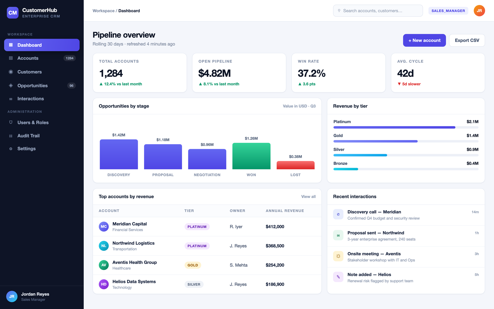
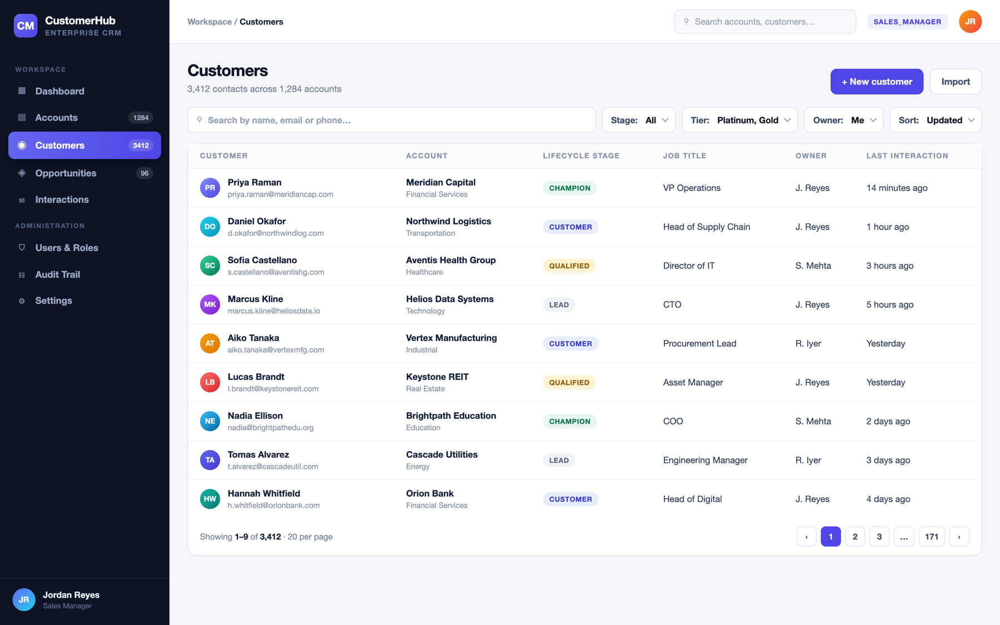

# Interface Preview

A walk through the interface and the reasoning behind each screen.

> **About the images.** The two figures below are **design previews** of the UI — rendered
> mockups used for documentation, populated with representative data at production scale so the
> charts, badges and density are legible. They are not screen captures of a running build, and
> the volumes shown (thousands of accounts) are deliberately larger than the small seeded demo
> dataset described at the bottom of this page. The prose describes the behaviour actually
> implemented in `frontend/src`.

---

## Dashboard



The landing screen, and the whole of it comes from a single request to
`GET /api/v1/dashboard/summary`.

- **Four KPI tiles** — open pipeline with its probability-weighted figure underneath, account
  totals split by status, contacts added this month, and interaction volume over the trailing 30
  days.
- **Pipeline by stage** — a grouped bar chart comparing total value against weighted value per
  stage. The gap between the two bars is the forecast risk in that stage.
- **Contact funnel** — a donut of contacts by lifecycle stage, so the shape of the funnel is
  visible without reading numbers.
- **Top accounts by revenue** — ranked, tier-badged, churned accounts excluded.
- **Activity mix** — call, email, meeting and note volume as proportional bars.

Every number here is a database aggregate, not a fold over entities loaded into the JVM. The
endpoint is cached for 60 seconds server-side and marked `Cache-Control: private, max-age=30`,
so re-entering the screen during a navigation costs nothing.

---

## Contacts



The server-paginated data table, and the screen that demonstrates most of the engineering in the
project.

- **Search** across first name, last name and email, debounced at 300 ms so typing does not issue
  a query per keystroke.
- **Filters** on lifecycle stage and account tier, composed independently — the tier filter walks
  the account association, which is why it is a `Specification` and not a repository method.
- **Sortable columns** that emit `property,direction` to the API. Sorting is never done in the
  browser: reordering the current page would misrepresent the other pages.
- **Pagination** with a page-size selector, capped server-side at 100 rows regardless of what the
  client asks for.
- **Role-gated actions.** The edit and delete controls, and the "New contact" button, are hidden
  for READ_ONLY. Hiding them is a courtesy; the API refuses the request independently.
- **Create / edit drawer** driven by react-hook-form with a Zod schema that mirrors the server's
  `jakarta.validation` constraints field for field, so common mistakes never cost a round trip.
- **Loading, empty and error states**, each distinct: a row skeleton while the first page loads,
  a "clear filters" call to action when a filter combination matches nothing, and a retryable
  panel when the request itself fails.

A sales rep sees the same rows as everyone else — visibility is company-wide — but is refused on
write for any contact they do not own, with a 403 carrying
`type: .../problems/ownership-required`.

---

## Other screens

| Screen | What it shows |
|---|---|
| **Login** | Split layout with a brand panel; one-click demo persona buttons for all four roles |
| **Accounts** | The same paged table pattern applied to companies, filterable by tier, status and industry, with revenue right-aligned and tier/status badges |
| **Pipeline** | Kanban board with a column per stage, each headed by its deal count and total value. Deals move stage via keyboard-accessible arrow controls rather than drag events, so the interaction works for screen-reader users too; closing a deal pins its probability server-side |
| **Activity** | Vertical timeline of every interaction, newest first, typed by channel icon, showing contact, account and author |
| **Users** | ADMIN only. Role badges, enabled state, last login. Explains in-page that a role change revokes the user's refresh chain so permissions cannot lag by up to 15 minutes |

---

## Seeing the real thing

```bash
cp .env.example .env
docker compose up --build
```

Open <http://localhost:3000> and sign in as `admin@slatecrm.io` / `Admin@12345`.

The seeded dataset is 5 accounts, 6 contacts, 6 opportunities across all five stages, and 5
recent interactions — deliberately small, but arranged so every chart, badge, filter and empty
state has something real to render. Your figures will therefore be much smaller than the
previews above; load `backend/src/main/resources/db/migration/V2__seed_reference_data.sql` or
point the API at your own database if you want volume.
